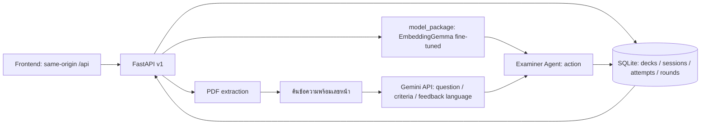

# AI Presentation Trainer — แผนลงมือทำฝั่ง Backend + RAG/Agent (คน B)

**ฉบับ 4 พฤศจิกายน 2569 | เจ้าของ: เพื่อน | อ้างอิงบังคับ: `contracts/v1/`**  
ไฟล์กลาง: [อธิบายระบบทั้งหมด](shared-system-overview-v1.md) | ไฟล์คู่กัน: [แผน Frontend](frontend-implementation-plan-v1.md)

## 1. เป้าหมายและขอบเขต

Backend รับ PDF สไลด์ 1–10 หน้า ดึงข้อความและค้นหน้าที่เกี่ยวข้อง สร้างคำถามหลักพร้อมเกณฑ์ที่ตรวจหลักฐานได้ ประเมินคำตอบด้วยโมเดลที่ทีม fine-tune เลือกคำถามเจาะหรือไปคำถามใหม่ด้วย Examiner Agent เก็บ session ให้ต่อหลัง refresh ได้ และสร้างรายงาน 3 รอบโดยไม่ชมคำตอบที่ไม่ครอบคลุม

**คน B เป็นเจ้าของ:** `backend/`, DB migration, PDF/RAG, Gemini, Examiner Agent, API และ model adapter คน A เป็นเจ้าของ `frontend/`, `training/`, `model_package/` รวมการติดป้ายข้อมูล fine-tune, checkpoint และ metrics ทั้งคู่แก้ `contracts/v1/` ได้เมื่อยืนยันการเปลี่ยนร่วมกัน Backend เรียก package ที่คน A ส่งมาโดยไม่แก้ training loop/checkpoint ข้ามเจ้าของ

**สถานะเริ่มต้น:** Backend prototype ใช้ Gemini ช่วยถามและประเมิน, SQLite เก็บเพียงคำตอบเดียวต่อคำถาม, ยังไม่มี criteria, model package, `attempt_id`, `state_version` หรือ `/api/ready` Report ยังไม่ใช่ schema v1 จึงต้องเปลี่ยนโครงสร้างก่อนอ้างว่า Frontend v1 ต่อได้

## 2. สัญญาที่ Backend ต้องส่งให้ Frontend

| Endpoint | รับ | ส่ง / เงื่อนไข |
|---|---|---|
| `GET /api/ready` | — | 200 เมื่อ DB, โมเดล และบริการสร้างคำถามพร้อม; 503 เมื่อไม่พร้อม พร้อม `database_ready`, `model_ready`, `question_service_ready`, `model_source` |
| `POST /api/decks` | multipart `file` PDF | `deck_id`, `filename`, `page_count`, `contract_version:1`; ปฏิเสธไฟล์อ่านไม่ได้/ไม่มีข้อความ |
| `GET /api/decks/{id}/file` | deck ID | PDF bytes `application/pdf` |
| `POST /api/sessions` | `{deck_id,difficulty}` | `session_id`, `question` พร้อม 1–3 criteria, `current_prompt`, `round:1`, `state_version:0`, `model_source`, `test_mode` |
| `GET /api/sessions/{id}` | session ID | state ล่าสุดครบ: deck metadata, question/current_prompt, attempts/history/coverage, round, version, completed |
| `POST /api/sessions/{id}/answers` | `{question_id,attempt_id,state_version,answer}` | state หลัง commit, `next_question`, prompt, attempts/history/coverage, feedback, Agent action/reason, `counted_round` |
| `GET /api/sessions/{id}/report` | session ID | เมื่อจบแล้วคืน 3 rounds พร้อม outcome/attempts/coverage/feedback; ก่อนจบคืน 409 |

ทุก JSON สำเร็จมี `status:ok`, `contract_version:1` ยกเว้น PDF bytes; error ปกติใช้ `{status:"error",error:{code,message}}` พร้อม HTTP status ตามเหตุการณ์ แต่ `/api/ready` ที่ไม่พร้อมเป็นกรณีพิเศษ: HTTP 503 กับ `status:unavailable` และ readiness booleans `model_source` เป็น `local_finetuned` หรือ `test_fake`; `test_mode` ต้องเป็น `true` เฉพาะ fake model **ห้ามส่งผล fake ในชื่อโมเดลที่เทรนแล้ว** รายละเอียด field และตัวอย่างครบอยู่ใน `contracts/v1/api.schema.json`, `model.schema.json`, `fixtures.json`

## 3. โครงสร้างภายในและกติกาที่ต้องตรงกัน

### ข้อมูลที่ต้องเก็บ

- `decks`: ID, filename, จำนวนหน้า, PDF path, ข้อความแต่ละหน้า, retrieval cache พร้อมชื่อโมเดล/รุ่น index เพื่อไม่ใช้ vector เก่าผิดรุ่น
- `sessions`: ID, deck ID, difficulty, คำถามหลักปัจจุบัน, `current_prompt`, `round`, `state_version`, coverage ปัจจุบัน, `completed`, `model_source/version`
- `attempts`: `(session_id, attempt_id)` unique, question ID, version ที่รับ, `prompt_at_attempt`, answer, raw model result/feedback/action, **response snapshot** สำหรับ replay
- `rounds`: session ID, round 1–3, question, outcome `complete|incomplete`, coverage สรุป, attempts ในรอบ, feedback และหน้าสไลด์

ใช้ migration ที่เพิ่มตาราง/คอลัมน์โดยไม่ลบข้อมูล prototype เดิม; ทดสอบ DB ใหม่และ DB เดิม การสาธิตเครื่องเดียวใช้ SQLite ได้ แต่ต้องมี transaction และ unique constraint; อย่าใช้หลาย Backend instances ที่มี DB/PDF แยกกัน

### ความหมายของคำถามและ state

- คำถามหลัก `question.id` ต้องคงเดิมเมื่อ action เป็น `probe`, `retry`, `clarify`; สิ่งที่เปลี่ยนคือ `current_prompt` และ `state_version`
- `round` คือจำนวนคำถามหลัก 1–3 ไม่ใช่จำนวนคำตอบ; ไม่เกิน 3 attempts ต่อคำถามหลัก; ปิดรอบแล้วเท่านั้นจึงเพิ่มรอบ
- `next` ปิดรอบ 1 หรือ 2 แล้วสร้างคำถาม ID ใหม่; `finish` ปิดรอบ 3 และคืน `next_question:null`, `current_prompt:null`, `completed:true`
- `counted_round:true` หมายถึงปิดรอบ แม้ `outcome:incomplete`; `history` มีเฉพาะรอบปิดแล้ว; `attempts` ใน response มีเฉพาะรอบปัจจุบัน
- คำตอบครั้งต่อไปต้องประเมินกับ `prompt_at_attempt` ที่ Backend เก็บเอง ไม่รับ prompt ที่ browser ส่งมาเป็นหลักฐาน

### การส่งซ้ำและ concurrency

1. รับ POST แล้วตรวจ `(session_id, attempt_id)` ที่เคย commit **ก่อน** ตรวจ state ปัจจุบัน; ถ้า request เหมือนเดิมทุก field ให้คืน response snapshot เดิมโดยไม่เพิ่ม attempt ถ้าต่างให้ 409
2. ถ้าเป็น attempt ใหม่ ตรวจ `question_id` และ `state_version` กับ session snapshot; stale ให้ 409 ก่อนเรียกโมเดล
3. ประมวลผล model/Agent/Gemini ที่จำเป็น **นอก transaction ที่ล็อก DB**; มี deadline รวมเป้าหมายไม่เกิน 120 วินาที
4. ก่อน commit เปิด transaction, ตรวจ version อีกครั้งแบบ compare-and-swap, เขียน attempt/round/session/response snapshot พร้อมกัน แล้ว commit ครั้งเดียว; ถ้า version เปลี่ยนให้ 409
5. ถ้า Gemini/model ตอบ 429/503/timeout ก่อน commit state ต้องไม่เปลี่ยน; Frontend retry ด้วย attempt ID เดิม หาก commit แล้ว response หาย การ retry ต้องคืน snapshot เดิม

## 4. งาน AI ที่ต้องทำจริง

### AI-1 — PDF และ RAG

1. ใช้ `backend/pdf_service.py` เป็นฐาน ตรวจ PDF ไม่เกิน 15 MB และ 1–10 หน้า มีข้อความอย่างน้อยหนึ่งหน้า; ไฟล์ภาพล้วนที่ดึงข้อความไม่ได้ตอบ `PDF_NO_TEXT`
2. เก็บ text พร้อมเลขหน้า 1-based; แบ่ง/เลือก chunk ที่ยังย้อนกลับหาหน้าเดิมได้ ทดลองค่าตั้งต้นราว 300 tokens, overlap 50, top 2 แล้วปรับจาก PDF ตัวอย่างจริง ค่านี้เป็น **สมมติฐานทดลอง** ไม่ใช่ผลที่พิสูจน์แล้ว
3. ใช้ retrieval model ที่กำหนดชัด (prototype ใช้ Gemini embedding API) และ cache โดยผูกกับชื่อโมเดล/รุ่น index; หากเปลี่ยนโมเดลต้องสร้าง cache ใหม่ หน้า 1 ที่มีเนื้อหาจริงต้องมีโอกาสถูกเลือก
4. ให้ Gemini สร้าง `question`, criteria 1–3 ข้อ, `source_page`, `evidence_quote`; Backend ตรวจว่าแต่ละ quote ปรากฏในข้อความหน้าอ้างอิงหลัง normalize whitespace และตรวจ token budget ก่อนเริ่ม session ถ้าไม่ผ่าน regenerate ในเวลาที่กำหนดหรือ 503 โดยไม่บันทึก session ที่ใช้ไม่ได้

### AI-2 — จุดรับโมเดลที่คน A เทรนและส่งมา

1. คน A เทรน `google/embeddinggemma-300m` ต่อและส่ง `model_package/`, tokenizer/config, dependency lock, checkpoint manifest/hash, model version และ metrics; คน B ไม่รับผิดชอบ train loop หรือเลือก checkpoint แต่ต้องตรวจว่าผลที่ส่งเข้ากับ API
2. สร้าง `backend/coverage_service.py` เป็น adapter เรียก `predict_attempt(question,current_prompt,criteria,answer)` และ `validate_attempt` หรือรับ `ModelInputTooLong`; ติดตั้ง package ใน environment ใหม่ร่วมกับ Backend และทดสอบหลัง restart
3. ตรวจว่า criterion IDs ที่โมเดลคืนตรงกับเกณฑ์คำถามทุกข้อ, status เป็น `covered|partial|missing`, confidence อยู่ 0–1, model version/hash ตรง manifest; ถ้าผิดให้ 503 โดยไม่ commit state
4. ใช้ tokenizer ของ package ตรวจ input ไม่เกิน 512 tokens; ส่วนคงที่ยาวเกินต้องแก้ตั้งแต่สร้างคำถาม คำตอบผู้ใช้ยาวเกินให้ 413 โดยไม่บันทึก attempt ห้ามตัดคำตอบเงียบ ๆ
5. หาก package/checkpoint ไม่พร้อมให้ `/api/ready` และคำขอที่ต้องใช้โมเดลตอบ 503 ชัดเจน ห้ามสลับไป Gemini หรือ fake model โดยไม่แจ้ง Fake predictor ใช้สำหรับ contract test เท่านั้นและต้อง `test_mode:true`

### AI-3 — Examiner Agent และ feedback

Agent รับผล coverage/off-topic จากโมเดล, coverage ที่สะสมใน session, จำนวน attempts และหลักฐานสไลด์ แล้วเลือก action ตามตารางนี้ **กติกาตัดสินใจอยู่ Backend**; Gemini ช่วยเขียนข้อความถามเจาะ/feedback แต่ไม่แทนผลโมเดลโดยพลการ

| เงื่อนไขหลังตรวจคำตอบ | ยังไม่ครบ 3 attempts | attempt ที่ 3 |
|---|---|---|
| เกณฑ์ครบและผลมั่นใจ | ปิด `complete`, ไป `next/finish` | ปิด `complete`, ไป `next/finish` |
| ขาดบางเกณฑ์ | `probe` เฉพาะประเด็นที่ขาด | ปิด `incomplete`, ไป `next/finish` |
| นอกเรื่อง | `retry` โดยไม่ชม | ปิด `incomplete`, ไป `next/finish` |
| `off_topic=true` แต่มี `covered` หรือ confidence ไม่พอ | `clarify` โดยไม่ชมเกินหลักฐาน | ปิด `incomplete`, ไป `next/finish` พร้อมเหตุผลว่าผลไม่ชัด |

เกณฑ์ที่เคย `covered` ต้องคงอยู่เมื่อคำตอบครั้งถัดไปนอกเรื่อง เว้นแต่ผู้ใช้แก้คำตอบเดิมชัดเจนและระบบยืนยัน รายงานต้องใช้ผลที่ยืนยันแล้วเท่านั้น คำตอบว่า “จัดมุมเงียบ ๆ” ควรได้ credit เฉพาะเกณฑ์มุมเงียบ แล้วถามต่อเรื่องที่หลบ; คำตอบ “จัดบ้านแมวให้เข้าไปหลบ” อยู่ในคำถามหลักเดิมและจึงปิดรอบได้เมื่อครบสองเกณฑ์

## 5. ขั้นลงมือทำและจุดส่งมอบ

### B0 — ยืนยัน contract

- รับ `contracts/v1/` ชุดเดียวกับคน A รัน `validate.py` และ `test_contract.py`; ตกลง endpoint, required/nullable fields, error code, timeout, fake/real mode
- ส่งตัวอย่าง response จริงจาก Backend fake model อย่างน้อย `start/probe/retry/next/incomplete/finish` ให้คน A เทียบ fixture
- หากเปลี่ยน field ให้แก้ schema/fixture/test ร่วมกันก่อนแก้โค้ด

**ผ่านเมื่อ:** response fake model ผ่าน contract และคน A parse ได้โดยไม่เติม field เอง

### B1 — DB/API state กับ fake model

- ทำ migration และ transaction ตามหัวข้อ 3; แยก service สำหรับ session, coverage aggregation, Agent และ model adapter จาก HTTP route
- สร้าง `/api/ready`, start/GET/answer/report v1; real mode ต้องมี Gemini config พร้อมจึงให้ `question_service_ready:true` (การล่มของผู้ให้บริการขณะเรียกจริงยังตอบ 429/503 ได้) ทดสอบ duplicate attempt, stale version, 3 attempts, incomplete และ restart
- ใช้ fake predictor **เฉพาะ test** โดยคืน `model_source:test_fake`, `test_mode:true` ทุก session/report response

**ผ่านเมื่อ:** contract flow 6 คำตอบทำผ่าน FastAPI TestClient; 409/413/429/503 ไม่ทำให้ state เปลี่ยนผิด

### B2 — RAG/คำถาม/หลักฐานจริง

- ต่อ PDF retrieval, Gemini question + criteria, quote verification, cache/version และ token budget; ทดสอบ PDF แมวกับ PDF ใหม่คนละหัวข้อ
- จำกัดจำนวน Gemini retries และเวลารวม; ถ้าสร้างเกณฑ์ที่อ้างหลักฐานไม่ได้ให้ตอบ 503 โดยไม่สร้าง session ที่ตอบต่อไม่ได้

**ผ่านเมื่อ:** ทุก criterion อ้าง quote ที่พบในหน้า PDF จริงและ Frontend เปิดหน้าอ้างอิงนั้นได้

### B3 — เชื่อม model package ที่คน A ส่ง

- รับ package/checkpoint/manifest/metrics จากคน A; ติดตั้งใน environment Backend ใหม่ โหลด checkpoint/tokenizer และตรวจ hash/version; ทดสอบ covered/partial/off-topic/คำตอบยาว
- ทดสอบ adapter กับ fake package ก่อน แล้วรันซ้ำกับ package จริง; ถ้า API result ไม่ตรง schema ให้คืน 503 โดยไม่บันทึก attempt และส่งตัวอย่าง input/output ที่ตัดข้อมูลส่วนตัวออกให้คน A แก้ package
- สลับ real mode แล้ว readiness/ทุก response แสดง `model_source:local_finetuned`, `test_mode:false`; หากโหลดไม่ได้ให้ 503 ไม่สลับไป Gemini เป็นผู้ตรวจโดยเงียบ ๆ

**ผ่านเมื่อ:** หลัง restart โมเดลจริงยังโหลดและ predict ได้; Backend ตรวจ manifest/IDs/token budget ผ่าน และอ้างผลวัดที่คน A ส่งมาได้ตามจริง

### B4 — ส่งให้ Frontend ต่อและทดสอบร่วม

- ส่งวิธีรัน Backend, dependency lock, API origin/proxy target, ตัวอย่าง curl/response, error codes, model artifact path และผล tests ให้คน A
- ต่อ Frontend ผ่าน same-origin `/api`; ทดสอบ PDF preview, refresh, response หายแล้ว retry, concurrency, report และ tunnel จากเครื่องอื่น
- อัปเดต `backend/README.md` และผลทดสอบหลังแก้บัคทุกครั้ง

**ผ่านเมื่อ:** integration matrix ในไฟล์ Frontend ครบ I1–I6 โดยไม่ต้องให้ browser ผู้ชมมี Backend บนเครื่องตัวเอง

## 6. แผนเวลา 2–3 วัน

| ช่วง | คน B ทำ | สิ่งที่ส่งคน A |
|---|---|---|
| วัน 1 | B0–B1: migration, API state, fake model, contract tests | API fake model และผลลัพธ์ตาม fixtures |
| วัน 2 | B2 + เตรียม B3: RAG/criteria และ adapter ทดสอบกับ fake package | Backend ที่ถาม/รายงานจาก PDF จริง; model input/output คงที่ให้คน A |
| วัน 3 | B3–B4: รับ package/checkpoint จากคน A, สลับ real mode, integration/tunnel/restart | ผลโหลดโมเดลจริง, API responses และวิธีรัน |

นี่เป็นลำดับเป้าหมาย ไม่รับประกันว่าคน A จะฝึกโมเดลเสร็จตามวัน หาก package จริงยังไม่พร้อมให้คง fake mode สำหรับทดสอบ API และแสดงสถานะตามจริง แต่การสาธิตว่า “ทีมเทรนโมเดล” ต้องมี checkpoint และผลวัดจริงก่อน

## 7. ชุดทดสอบก่อนประกอบและก่อนสอบ

1. Contract: schema/fixture และคำตอบ 6 attempts ตามลำดับ; probe/clarify ไม่เพิ่มรอบ, attempt ที่ 3 ต้องปิดรอบ
2. State: POST เดิมซ้ำคืน snapshot เดิม; attempt ID เดิมแต่ payload ต่างเป็น 409; state_version เก่าถูก 409; GET หลัง restart ตรงกับก่อน restart
3. Error: 413 ไม่มี attempt ใหม่; Gemini 429 และ model 503 ไม่ commit; readiness 503 เมื่อ model/DB ไม่พร้อม
4. AI: criterion IDs ตรง, confidence อยู่ 0–1, quote พบในหน้า PDF, off-topic+covered ไม่สร้างคำชม, ทดสอบคำตอบมั่ว/แสลง/คำหยาบ/คำสั่งหลอกหลายแบบ
5. Report: exactly 3 rounds; แต่ละรอบมี attempts จริง, outcome ถูก, incomplete ไม่กลายเป็น covered ใน overall
6. Deployment: Backend/DB/PDF อยู่ instance เดียวกัน, key อยู่ `backend/.env`, reverse proxy `/api` ทำงานกับ `dist/`, เปิดผ่าน tunnel จากเครื่องอื่นได้

**เกณฑ์จบ:** API fake ผ่านสัญญา, real model โหลดและให้ผลวัดจริง, Frontend ใช้ state ที่ Backend บันทึก, และ flow อัปโหลดจนถึงรายงานผ่านบนเครื่องอื่น หากข้อใดยังไม่ผ่านให้ระบุอาการกับเจ้าของแก้ ไม่ถือว่า integration เสร็จ

**หมายเหตุ:** ไฟล์นี้เป็นแผนลงมือทำ ไม่ใช่คำกล่าวว่า Backend/โมเดลปัจจุบันรองรับ v1 แล้ว
