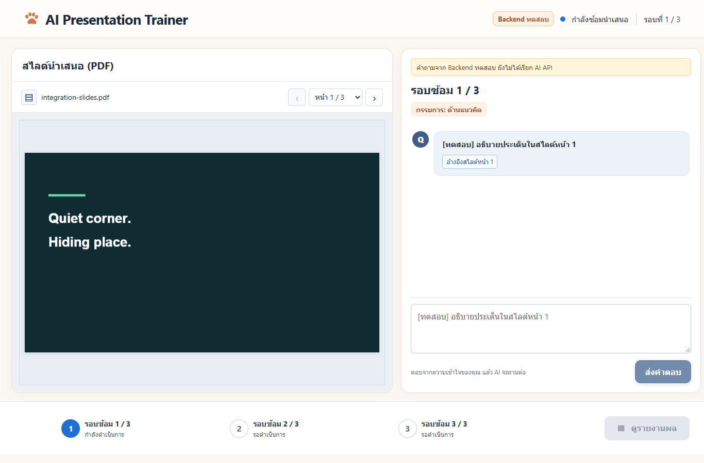
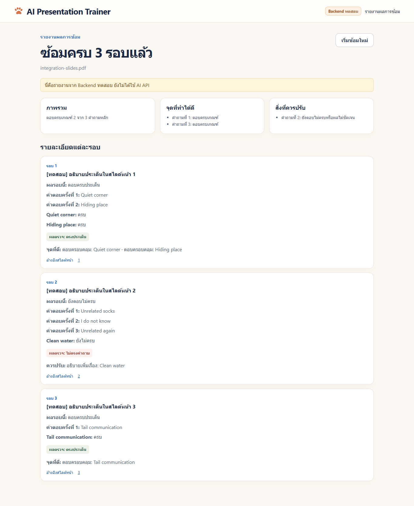

# Frontend + Backend integration — 5 พฤศจิกายน 2569

ทดสอบ Frontend commit `133b2a8e9d2821c2233f35bed5adb382b62af10d` กับ Backend runtime จาก commit `8056755d22715b058ed8240751f0cb96a3793a96` บน Windows ใช้ FastAPI, SQLite และ PDF ของจริง ส่วน predictor/การสร้างคำถามเป็น `test_fake` ไม่ใช่ fixture API server และไม่ใช่ผลโมเดลที่ฝึกแล้ว

## ผลที่ได้

| รายการ | ผล |
|---|---|
| Frontend ต้นฉบับก่อนแก้ recovery | ผ่าน 9 จุด ไม่ผ่าน 2 จุด ดู `integration-results/baseline.json` |
| Frontend candidate ผ่าน Vite proxy | ผ่าน 12 จุด ดู `integration-results/development.json` |
| Frontend candidate build และ FastAPI static serving | ผ่าน 12 จุด ดู `integration-results/production.json` |
| Backend suite รวม acceptance/RAG tools | ผ่าน 35 tests, 19.57 วินาที |
| Frontend production build | ผ่าน มี warning bundle หลักใหญ่กว่า 500 kB |
| Gemini/RAG live preview | ผ่าน PDF สังเคราะห์ 4 หัวข้อ เกณฑ์/quote รวม 8 จุด ดู `integration-results/live-rag.json` |
| Public tunnel/อุปกรณ์อีกเครื่อง | ยังไม่ทดสอบ พบว่ายังไม่มี cloudflared/ngrok ใน PATH |

ผล candidate ใช้ Frontend commit ข้างต้น **บวก local patch** ใน `../integration/frontend-recovery.patch` ยังไม่ได้รวม patch เข้า branch `feat/frontend-v1` บน GitHub จึงไม่ควรอ้างว่า Frontend ต้นฉบับผ่านทั้งหมดแล้ว

## ปัญหาที่พบและ patch

1. Frontend ลบ pending request เมื่อได้ 503 ทำให้ส่งใหม่ด้วย attempt ID ใหม่ การแก้คงคำขอเดิมไว้และล้างเฉพาะ 413 ที่ต้องแก้ข้อความ
2. Refresh ขณะ Backend ปิดทำให้ catch ลบ session ID แม้เป็นความผิดพลาดชั่วคราว การแก้ลบ ID เฉพาะ 404 ที่ยืนยันว่า session ไม่พบจริง เมื่อ Backend กลับมาแล้ว refresh จะกู้ session และ pending answer เดิมได้

Patch มีเฉพาะ `frontend/src/App.jsx` ไม่เปลี่ยน API/schema คน A ต้องตรวจและนำ patch ไปใช้ก่อนอ้างผล candidate นี้กับ branch ของตน

PDF demo เดิมของ Backend เป็นแนวตั้ง แต่ Frontend ล่าสุดตรวจว่าเป็นสไลด์แนวนอน จึงเพิ่ม `examples/acceptance/integration-slides.pdf` 3 หน้า ขนาด 960×540 สำหรับ flow หน้าเว็บ ไม่ลดหรือปิดการตรวจไฟล์ของ Frontend

## สิ่งที่ทดสอบผ่านหน้าเว็บจริง

- อัปโหลด PDF จริง ดึงคำถามจากข้อความที่อ่านได้ และวาด PDF canvas จน loading หาย
- Double click ส่งคำตอบไม่เพิ่ม attempt ผิด; duplicate POST เดิม replay snapshot เดิม และ payload ต่างเป็น 409
- ตอบบางเกณฑ์แล้วถามเจาะโดยคง question ID/round; refresh กู้ attempt และ probe จาก DB
- 413 เก็บข้อความไว้ให้แก้และไม่บันทึก attempt
- Browser offline เก็บคำตอบ/pending ไว้ แล้วกลับมาออนไลน์และ refresh เพื่อส่งต่อได้
- 503 ที่ฉีดก่อน commit คง payload เดิมและไม่เปลี่ยน state
- ปิด process Backend แล้วเปิดใหม่ด้วย storage เดิม กู้ session และ retry ด้วย ID/version/answer เดิม
- จบ 3 รอบด้วย outcome complete/incomplete/complete และ attempts 2/3/1; รายงานไม่แสดง incomplete เป็นตอบครบ
- คลิกปุ่มเลขหน้าในรายงานแล้วเปิด PDF หน้านั้นได้
- API ที่ browser เรียกทั้งหมดอยู่ origin เดียวกับ UI และไม่พบ page JavaScript errors

503 เป็นการฉีด HTTP response ที่ browser layer เพื่อทดสอบ client recovery ส่วน offline และ process stop เป็น fault จริงในเครื่อง คำขอสำเร็จและการตรวจ state/report ทั้งหมดเรียก FastAPI จริงผ่าน HTTP

ในโหมด production เมื่อหยุด FastAPI หน้า static ก็ไม่พร้อมด้วย จึงตรวจ storage ของหน้าเว็บที่เปิดอยู่ แล้วเปิดเซิร์ฟเวอร์ใหม่ก่อน refresh ไม่อ้างว่าหน้าใหม่โหลดได้ระหว่าง static server ปิด





## รันทดสอบซ้ำ

ใช้ Frontend checkout ของจริงที่ติดตั้ง dependencies แล้วและรวม patch ข้างต้น จากราก Backend repo:

```powershell
node backend/tools/integration-smoke.mjs --frontend C:/path/to/frontend --python C:/path/to/backend/.venv/Scripts/python.exe

# Build Frontend ก่อน แล้วตรวจ static serving
node backend/tools/integration-smoke.mjs --production --frontend C:/path/to/frontend --python C:/path/to/backend/.venv/Scripts/python.exe
```

ปรับ path ให้ตรงเครื่อง `--frontend` ต้องเป็นโฟลเดอร์ที่มี package.json/Playwright/Vite ใช้ Chrome ที่ติดตั้งในเครื่อง หรือระบุ `--chrome` Script เลือก port ว่างเอง ใช้ storage แยกใต้ `.integration/` และปิด browser/server เมื่อทดสอบจบ ไม่มีการแก้ DB สาธิตจริงหรือส่งคำขอไป Gemini

## งานที่พร้อมทำต่อ

เตรียม PDF สังเคราะห์ 4 หัวข้อที่คัดลอกโดยไม่แก้ bytes พร้อม quote/page ที่ตรวจได้ และ acceptance 23 กรณีใน `examples/acceptance/model-cases.json` เป็น target labels ที่ยังต้องให้คนตรวจ ไม่ใช่ผลประเมินโมเดลจริง

ใช้ `tools/check_rag.py` ทดสอบ live retrieval/question preview แล้วด้วย `gemini-3.5-flash-lite` และ `gemini-embedding-001` ตาม config ใน `backend/.env` ที่ไม่ติดตามใน Git คำถามทั้ง 4 เรื่องและเกณฑ์ 8 ข้ออ้างอิงข้อความใน PDF ได้จริง แต่ยังไม่ใช่ผลทดสอบคุณภาพบนเอกสาร/คำตอบจากผู้ใช้จริง ไม่ได้ตรวจ token budget ด้วย tokenizer ของ checkpoint หรือประเมินคำตอบ ดูคำสั่งรันซ้ำใน `demo-runbook.md`

การตรวจ provider แยกส่วนได้ HTTP 200 ทั้ง embedding และ generation รุ่น `gemini-2.5-flash-lite` ที่ลองก่อนหน้าตอบ 404 ว่าไม่รองรับผู้ใช้ใหม่ จึงเปลี่ยน config เป็น [Gemini 3.5 Flash-Lite](https://ai.google.dev/gemini-api/docs/models/gemini-3.5-flash-lite) ตามข้อความที่ provider แนะนำและทดสอบเรียกจริงสำเร็จแล้ว ไม่เปลี่ยน model อัตโนมัติใน runtime

การเปิด tunnel และการตรวจจากอีกเครื่องมีลำดับสาธิตพร้อมแล้วใน `demo-runbook.md` ต้องรันทดสอบจริงก่อนเปลี่ยนสถานะรายการนี้เป็นผ่าน
