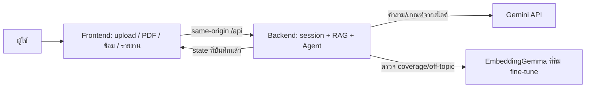

# AI Presentation Trainer — แผนลงมือทำฝั่ง Frontend + เทรนโมเดล (คน A)

**ฉบับ 4 พฤศจิกายน 2569 | เจ้าของ: เรา | อ้างอิงบังคับ: `contracts/v1/`**  
ไฟล์กลาง: [อธิบายระบบทั้งหมด](shared-system-overview-v1.md) | ไฟล์คู่กัน: [แผน Backend + AI](backend-ai-implementation-plan-v1.md)

## 1. ระบบที่เรากำลังสร้าง

AI Presentation Trainer เป็นเว็บสำหรับซ้อมนำเสนอจาก PDF สไลด์ 1–10 หน้า ผู้ใช้เลือกความยาก อัปโหลดไฟล์ อ่านคำถามจากเนื้อหาจริง ตอบและรับคำถามเจาะต่อได้สูงสุด 3 ครั้งต่อคำถามหลัก รวม 3 คำถามหลัก แล้วดูรายงานที่บอกว่าตอบครบเกณฑ์ใด ขาดอะไร และอ้างสไลด์หน้าไหน

**ขอบเขตคน A:** รับ `frontend/`, `training/`, `model_package/` ทำ UI, เตรียม/ติดป้ายข้อมูล, fine-tune, ประเมินผล และส่ง package/checkpoint ให้เพื่อน คน A ไม่คำนวณคะแนนใน browser ไม่เรียก Gemini จาก browser และไม่แก้ DB/Agent ฝั่งเพื่อนรับ `backend/` รวม RAG/Gemini/Agent และ adapter ที่เรียก package เอกสาร `contracts/v1/` เป็นจุดต่อกลางที่ต้องตกลงก่อนเปลี่ยน

**สถานะเริ่มต้น:** เว็บ prototype เปิดได้ แต่ `frontend/src/api.js` ยัง fallback ไป `localhost:8000`, ส่งคำตอบโดยไม่มี `attempt_id`/`state_version` และทิ้ง HTTP error code; `frontend/src/App.jsx` เพิ่ม history เองทุกคำตอบและยังไม่รองรับหลาย attempts ในคำถามเดียว Backend prototype ก็ยังไม่ใช่ v1 จึงต้องใช้ mock API ของสัญญาก่อนต่อจริง

## 2. สิ่งที่ต้องรับจาก Backend และความหมาย

| เหตุการณ์ | Endpoint / request | สิ่งที่ Frontend ใช้ |
|---|---|---|
| ตรวจพร้อมใช้ | `GET /api/ready` | `database_ready`, `model_ready`, `question_service_ready`, `model_source`; ถ้า 503 แจ้งว่าระบบยังไม่พร้อม |
| อัปโหลด | `POST /api/decks` multipart field `file` | `deck_id`, `filename`, `page_count`; PDF 1–10 หน้า |
| แสดง PDF | `GET /api/decks/{id}/file` | ไฟล์ `application/pdf` สำหรับ PDF.js |
| เริ่ม | `POST /api/sessions` `{deck_id,difficulty}` | `session_id`, `question`, `current_prompt`, `round=1`, `state_version=0`, `test_mode` |
| กลับมาหลัง refresh / 409 | `GET /api/sessions/{id}` | state ล่าสุด: `question`, `current_prompt`, `attempts`, `history`, `coverage`, `round`, `state_version`, `completed` |
| ส่งคำตอบ | `POST /api/sessions/{id}/answers` `{question_id,attempt_id,state_version,answer}` | `next_question`, `current_prompt`, `attempts`, `history`, `coverage`, `agent_action`, `counted_round`, `completed`, `feedback` |
| ดูผลหลังจบ | `GET /api/sessions/{id}/report` | `overall`, `rounds[3]`; แต่ละรอบมี `outcome`, `attempts[]`, `coverage`, `feedback`, `source_pages` |

ทุก JSON สำเร็จมี `status:ok`, `contract_version:1` ยกเว้น endpoint PDF ที่คืน bytes; `test_mode=true` ต้องขึ้นป้ายชัดเจนว่าเป็น fake model/โหมดทดสอบ ไม่เสนอเป็นผล AI ที่เทรนแล้ว ตัวอย่าง payload อยู่ใน `contracts/v1/fixtures.json` และ schema อยู่ใน `api.schema.json`

### กติกา state ที่ต้องใช้ตรงกัน

- `question.text` คือคำถามหลัก; `current_prompt` คือข้อความที่ต้องตอบขณะนี้ ถ้าถามเจาะ `question.id` และ `round` **ไม่เปลี่ยน**
- `attempts[]` คือคำตอบในคำถามหลักปัจจุบัน; `history[]` คือคำถามหลักที่ปิดแล้ว Frontend แสดงตามข้อมูลที่ Backend ส่งและไม่ append history/เพิ่มรอบเอง
- การส่งใหม่แต่ละครั้งสร้าง UUID `attempt_id`; retry **คำขอเดิม** ใช้ UUID, คำตอบ และ `state_version` เดิม คำตอบใหม่หลัง probe ใช้ UUID ใหม่และ version ล่าสุด
- ถ้าผล POST ที่เล่นซ้ำมี `state_version` ต่ำกว่าที่หน้าเว็บมีอยู่ ให้โหลด GET session แทนการนำ state เก่ามาทับ
- `counted_round=true` แปลว่าปิดรอบ ไม่ได้แปลว่าตอบถูก `outcome` ของรอบที่ปิดอาจเป็น `incomplete`

## 3. งานเป็นขั้นตอน พร้อมผลลัพธ์ที่ตรวจได้

### F0 — รับสัญญาและตั้งจุดเริ่ม

1. ใช้ `contracts/v1` รุ่นเดียวกับเพื่อน; รัน `validate.py` และ `test_contract.py` จากชุดที่ส่งต่อ
2. บันทึกรายการหน้าจอที่ต้องมี: upload, PDF preview, practice, loading, error, report; เก็บหน้า demo เดิมไว้แต่ต้องติดป้ายว่าไม่ประเมินจริง
3. ตรวจว่าไฟล์ secret อยู่ Backend เท่านั้น และตั้ง `.gitignore` ไม่ให้ `.env`, PDF ผู้ใช้, DB, checkpoint ถูก push โดยพลั้งมือ

**ผ่านเมื่อ:** สองฝ่ายยืนยันชื่อ field/enum และ fixture ชุดเดียวกัน; ยังไม่ต้องรอ Backend v1 รันได้

### F1 — API client และ URL ที่ใช้จากเครื่องอื่นได้

1. ปรับ `frontend/src/api.js` ให้เรียก path `/api/...` บน origin เดียวกัน ค่าปริยายต้องไม่ใช่ `http://localhost:8000` ของผู้ชม
2. เพิ่ม Vite dev proxy ส่ง `/api` ไป Backend เครื่องที่รันจริง; สำหรับ `dist/` ต้องมี reverse proxy หรือ Backend เสิร์ฟ static เพราะ Vite dev proxy ไม่ติดไปกับ build
3. API client เก็บ `httpStatus`, `error.code`, `error.message` ใน error object; `GET /api/ready` ที่ตอบ 503 เป็นกรณีพิเศษซึ่งมี `status:unavailable` และ readiness booleans แทน `error` จึงต้องเก็บ body นี้ด้วย; timeout 150 วินาที ขณะ Backend คุมเวลารวมเป้าหมายไม่เกิน 120 วินาที
4. `deckFileUrl` ต้องใช้ same-origin เช่นเดียวกับ JSON API; ห้ามใส่ `GEMINI_API_KEY` ใน `VITE_*`

**ผ่านเมื่อ:** เครื่องอื่นเปิดหน้าเว็บและ PDF ได้, browser network เรียก `/api`, error 409/413/429/503 แยกได้

### F2 — จัด state หน้าเว็บให้ตรงกับ Backend

1. แยก `question`, `currentPrompt`, `attempts`, `history`, `coverage`, `stateVersion`, `completed`, `modelSource`, `testMode` ให้ชัด; `normalizeQuestion` ต้องไม่ทิ้ง `criteria`
2. ทำฟังก์ชันเดียวสำหรับแปลง `GET session` และ `POST answer` ให้เป็น view state; POST ใช้ `next_question` ส่วน GET ใช้ `question`
3. หลัง refresh โหลด `GET /sessions/{id}` แล้วคืนหน้าซ้อมพร้อมคำถามเจาะ/attempts ล่าสุด; ถ้า `completed` โหลด report
4. หน้าซ้อมแสดงคำถามหลักกับ prompt ที่ถามตอนนี้ แสดงคำตอบเดิมหลายครั้งภายในรอบเดียว และแสดง coverage เฉพาะที่ Backend ยืนยัน
5. Progress 3 ขั้นตาม `round/history/completed`; แสดง loading แบบสถานะงานที่กำลังทำ ไม่แสดงเปอร์เซ็นต์ปลอมของ Gemini

**ผ่านเมื่อ:** fixture `probe/retry/clarify` คงรอบและ question ID; `next` เพิ่มรอบหนึ่งครั้ง; `finish` เปิดรายงานได้

### F3 — ส่งคำตอบแบบปลอดการซ้ำ

1. ก่อน POST สร้าง `attempt_id` UUID และจับคู่กับ `question_id`, `state_version`, `answer` ณ เวลากดส่ง; ปิดปุ่มระหว่างรอ
2. เก็บคำขอที่ยังไม่ทราบผลไว้ชั่วคราวใน `sessionStorage` ของแท็บ เพื่อ retry ด้วยข้อมูลเดิมหลัง timeout/refresh; เมื่อสำเร็จหรือยืนยันจาก GET ว่า attempt ถูกบันทึกแล้วจึงล้าง
3. เมื่อ 409 โหลด GET session และเปรียบเทียบ attempt ID ใน `attempts/history`; ถ้าพบแล้วถือว่า submit สำเร็จ ถ้าไม่พบให้ผู้ใช้ตรวจ prompt ล่าสุดก่อนส่งคำตอบใหม่
4. 413 ไม่ล้างช่องตอบ; 429/timeout ไม่สร้าง UUID ใหม่สำหรับคำขอเดิม; 503 แจ้งว่า Backend/โมเดลไม่พร้อมและคงข้อความตอบ
5. ใช้ state จาก response ที่บันทึกแล้วเท่านั้น ไม่สร้าง feedback หรือคำชมเอง

**ผ่านเมื่อ:** กดซ้ำ/response หายไม่เกิด bubble หรือ attempt ซ้ำ; คำตอบต่อจาก probe ใช้ version ใหม่; refresh แล้วไม่กลับไป prompt เก่า

### F4 — หน้ารายงานและหลักฐาน

1. `ReportView` แสดงแต่ละ `round.question.text`, `outcome`, `attempts[]` ตามลำดับ และ `coverage` ต่อ criterion; `answer` รวมมีไว้รองรับข้อมูลเก่า ไม่ใช้แทน attempts หลัก
2. แสดงจุดดีเฉพาะที่ feedback/coverage ยืนยัน; `incomplete` ต้องมีป้ายชัดและไม่ใช้คำว่า “ตอบถูกทั้งหมด”
3. ปุ่มเลขหน้าสไลด์ต้องเปิด PDF หน้าที่อ้างอิง และต้องไม่เกิน `page_count`
4. แยกป้าย demo/fake model/real model ชัด ทั้งหน้าซ้อมและรายงาน

**ผ่านเมื่อ:** รายงาน fixture รอบที่ 2 เป็น `incomplete` พร้อม 3 attempts; ข้อความคำตอบมั่วไม่มีคำชมที่ระบบไม่ได้ยืนยัน

### F5 — ทดสอบแยกฝั่งและส่งมอบ

1. ทำ mock API จาก fixtures สำหรับ `start → probe → next → retry → retry_again → incomplete → finish`; mock ต้องตอบ status/code และ PDF ได้ตามสัญญา
2. ทดสอบใน browser: PDF ใหม่, refresh ระหว่าง probe, submit ซ้ำ, 409/413/429/503, report, จอมือถือ และโหมดตัวอย่าง
3. รัน `npm run build`; อัปเดต `frontend/README.md` ให้ตรงกับ v1 และระบุวิธีรัน proxy/build
4. ส่งให้เพื่อน: source `frontend/`, คำสั่งรัน, screenshot ของ flow, ผล test และรายการ API ที่ต้องรอ Backend จริง

**ผ่านเมื่อ:** Frontend ใช้ fixtures ได้ครบโดยไม่เรียก Gemini หรือ DB; browser network ไม่มี `localhost:8000` จากเครื่องผู้ชม

### M0–M4 — งานเทรนโมเดลที่เรารับเพิ่ม

งานนี้ทำใน `training/` และ `model_package/` แยกจาก `frontend/` โดยสิ้นเชิง; browser ไม่โหลด checkpoint และไม่รัน Python model

1. **M0 กำหนดข้อมูล/label:** สร้างคู่มือว่า `covered`, `partial`, `missing`, `off_topic` ต่างกันอย่างไร ใช้ตัวอย่าง `(question,current_prompt,criterion,answer)` จากสไลด์หลายเรื่อง รวมคำตอบสั้น แสลง คำมั่ว และคำสั่งหลอก แยก train/validation/test ตาม deck หรือหัวข้อก่อนฝึกเพื่อกันข้อมูลรั่ว ให้เพื่อนตรวจตัวอย่าง label บางส่วน
2. **M1 baseline:** ใช้ EmbeddingGemma เดิมหรือกติกาง่าย ๆ เป็นจุดเปรียบเทียบ บันทึกวิธีเตรียม input และผลบน validation โดยไม่เติมตัวเลขที่ยังไม่ได้วัด
3. **M2 fine-tune:** นำ `google/embeddinggemma-300m` ซึ่งเป็นโมเดลสำเร็จรูปมาเทรนต่อด้วย LoRA/หัวจำแนกสำหรับ coverage ต่อ criterion และ off-topic ทดลอง batch/sequence บน GPU ที่มีจริง บันทึก seed, รุ่นข้อมูล, hyperparameters, checkpoint และข้อจำกัดทรัพยากร หากหน่วยความจำไม่พอให้ปรับ batch/accumulation หรือใช้ cloud GPU
4. **M3 ประเมิน:** เลือก checkpoint/threshold จาก validation เท่านั้น แล้ววัด precision, recall, F1 แยก class, macro F1, off-topic F1, false praise rate และ confusion matrix บน test ที่แยกไว้ เก็บตัวอย่างที่โมเดลตอบผิดเพื่ออธิบายข้อจำกัด
5. **M4 ส่ง package:** ทำ `predict_attempt(question,current_prompt,criteria,answer)` และ `validate_attempt` หรือ `ModelInputTooLong` ที่ใช้ tokenizer เดียวกัน จำกัด input 512 tokens คืน criterion IDs เดิม, status/confidence, off-topic และ model version แนบ tokenizer/config, dependency lock, checkpoint manifest/hash, วิธีติดตั้งและตัวอย่าง input/output Package ต้องไม่ import Backend, ไม่อ่าน DB และไม่เรียก Gemini

**ผ่านเมื่อ:** คน B ติดตั้ง package ใน environment ใหม่ได้, โหลด checkpoint หลัง restart ได้, ผลลัพธ์ตรง `contracts/v1/model.schema.json` และมี metrics จริงจาก test ที่ไม่ใช้ train; หากยังเป็น fake ต้องติดป้ายว่าเป็นโหมดทดสอบ

## 4. ลำดับประกอบกับฝั่งเพื่อน

| จุดประกอบ | คน A ส่ง/ตรวจ | คน B ส่ง/ตรวจ | ผลที่ต้องเห็น |
|---|---|---|---|
| I1: Contract | UI mock + model package interface ใช้ fixtures | API fake model ผ่าน schema/fixtures | field/enum/nullable ตรงกัน |
| I2: เริ่มซ้อม | upload, PDF preview, start | PDF/RAG/คำถามพร้อม criteria | เปิดสไลด์และคำถามแรกได้ |
| I3: ถามเจาะ | ส่ง UUID + version, แสดง prompt/attempts | Agent + state transaction | คำถามเดิมไม่เพิ่มรอบก่อนปิด |
| I4: จบรอบ/รายงาน | แสดง complete/incomplete, แหล่งอ้างอิง | report 3 รอบจาก DB | คำตอบไม่ครบไม่ถูกชมเกินจริง |
| I5: โมเดลจริง | ส่ง package/checkpoint/manifest/metrics และแสดง `test_mode=false` ตาม API | ติดตั้ง package, ทำ adapter, โหลด checkpoint จริง | `/api/ready` พร้อมและ restart แล้วยังโหลดได้ |
| I6: Tunnel | เปิดจากเครื่องอื่น, PDF + `/api` | Backend/DB/PDF อยู่เครื่องเดียว | ไม่มี request ไป localhost ของผู้ชม |

**ถ้า I1 ไม่ผ่าน:** หยุดที่ contract แก้ schema/fixture ร่วมกันก่อนแก้ UI หรือ Backend แบบแยกกัน ห้ามเพิ่ม field เฉพาะฝั่งใดฝั่งหนึ่งโดยไม่เปลี่ยนสัญญา

## 5. แผนเวลา 2–3 วัน

| ช่วง | คน A ทำ | จุดเช็กกับคน B |
|---|---|---|
| วัน 1 | F0–F2 + M0: API client, proxy, mock, state และคู่มือ label/ชุดข้อมูล | ยืนยัน API fixture และตัวอย่าง label |
| วัน 2 | F3–F4 + M1–M2: retry/report, baseline, fine-tune รอบแรก | ต่อ Backend fake model; ตรวจ model input/output กับ adapter |
| วัน 3 | F5 + M3–M4 + I5–I6: metrics, package, tunnel, regression | ติดตั้ง package จริง, ตรวจ PDF ใหม่, refresh, error, restart, remote browser |

หากโมเดลจริงยังไม่พร้อมในวัน 2 ให้ทำ integration ด้วย fake model ที่ติดป้ายชัดก่อน แล้วสลับเป็น checkpoint จริงและทดสอบซ้ำ ไม่กล่าวว่า fine-tune สำเร็จจากผล fake

## 6. รายการส่งงานและเกณฑ์จบ

- `frontend/` build ผ่านและทดสอบกับ contract fixtures ผ่าน; `model_package/` ติดตั้งได้และ inference ตรง schema
- หน้าเว็บรับและแสดง state จาก Backend เป็นแหล่งข้อมูลจริง; ไม่มีการเพิ่มรอบ/ให้คะแนนเอง
- หน้าเว็บจัดการ 409, 413, 429, 503 และ timeout ได้ตามที่กำหนด
- เมื่อเชื่อม Backend จริงแล้ว ผู้ใช้เปิดจากเครื่องอื่นผ่าน tunnel, อัปโหลด PDF, ถามเจาะ, จบ 3 รอบ และดูรายงานได้
- อัปเดตคู่มือรันจริงและแนบผลทดสอบ; ข้อที่ยังไม่ผ่านบันทึกอาการ, request/response ที่ตัดข้อมูลส่วนตัวออก, เจ้าของที่ต้องแก้ และวิธีตรวจซ้ำ
- ส่ง checkpoint, manifest/hash, dependency lock และผลวัด baseline เทียบ fine-tune ให้เพื่อนโดยไม่ push ไฟล์โมเดลใหญ่/ข้อมูลลับลง Git

**หมายเหตุ:** แผนนี้เป็นงานที่จะลงมือทำ ไม่ใช่การยืนยันว่า Frontend ปัจจุบันรองรับ v1 แล้ว
