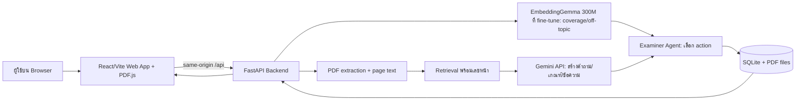
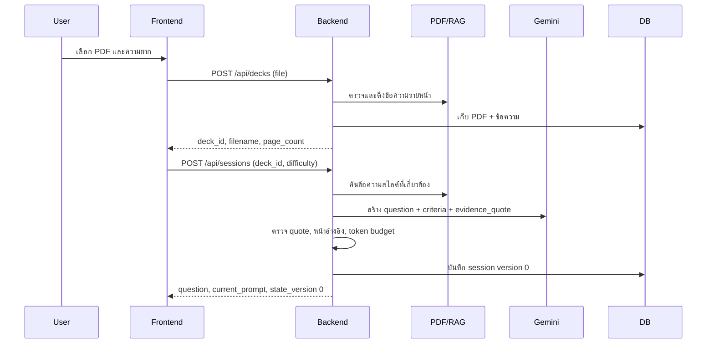

# AI Presentation Trainer — เอกสารกลางอธิบายระบบ

**ฉบับ 4 พฤศจิกายน 2569 | ใช้อ่านร่วมกันทั้ง 2 ฝ่าย**  
แผนลงมือทำแยกอยู่ที่ [Frontend](frontend-implementation-plan-v1.md) และ [Backend + AI](backend-ai-implementation-plan-v1.md) ส่วนรูปแบบข้อมูลที่ต้องใช้ตรงกันอยู่ใน `contracts/v1/`

## 1. เราทำระบบอะไร

AI Presentation Trainer เป็นเว็บแอปสำหรับ **ซ้อมตอบคำถามหลังนำเสนอสไลด์** ผู้ใช้อัปโหลด PDF ของตนเอง ระบบอ่านเนื้อหาสไลด์แล้วทำหน้าที่เป็นกรรมการซ้อม: ตั้งคำถามจากหลักฐานในสไลด์ ฟังคำตอบ ตรวจว่าตอบครบประเด็นหรือยัง ถ้ายังขาดจะถามเจาะต่อในเรื่องเดิม และเมื่อจบจะสร้างรายงานพร้อมจุดที่ทำได้ดี จุดที่ต้องปรับ และหน้าสไลด์อ้างอิง

เป้าหมายการสาธิตคือให้เห็นการประมวลผลจริงตั้งแต่ **PDF ใหม่ → คำถามจากสไลด์ → ตอบบางส่วน → AI ถามเจาะ → ตอบเพิ่ม → รายงาน** ระบบมี 3 คำถามหลัก แต่ละคำถามตอบได้ไม่เกิน 3 ครั้ง การถามเจาะไม่เพิ่มเลขรอบ หากครบ 3 ครั้งแล้วยังไม่ครบเกณฑ์ ให้ปิดรอบเป็น `incomplete` ตามจริง

ระบบเป็นซอฟต์แวร์ล้วน ไม่มีอุปกรณ์หรือเซนเซอร์ ผู้ใช้เปิดผ่าน browser ได้ทั้งในเครื่องเจ้าของและจากเครื่องอื่นผ่าน tunnel เมื่อจัด reverse proxy ถูกต้อง

## 2. ประสบการณ์ผู้ใช้ตั้งแต่ต้นจนจบ

1. **เตรียมสไลด์:** ผู้ใช้เลือก PDF 1–10 หน้าและระดับคำถาม `basic`, `standard` หรือ `challenge` ไฟล์ต้องมีข้อความที่ดึงได้; PDF ภาพล้วนที่ไม่มีข้อความจะได้รับ error ชัดเจน
2. **เริ่มซ้อม:** เว็บแสดง PDF ทางหนึ่งและคำถามทางหนึ่ง Backend สร้างคำถามจากข้อความที่ค้นพบในสไลด์ พร้อมเกณฑ์คำตอบ 1–3 ข้อและเลขหน้าอ้างอิง
3. **ตอบคำถาม:** ผู้ใช้พิมพ์คำตอบ ระบบตรวจความเกี่ยวข้องและความครอบคลุมของแต่ละเกณฑ์ ถ้าตอบเพียงบางส่วน ระบบถามเจาะประเด็นที่ยังขาดโดยใช้คำถามหลักเดิม
4. **ดำเนินรอบต่อ:** เมื่อครบเกณฑ์หรือใช้โอกาสตอบ 3 ครั้ง ระบบปิดรอบ บันทึกว่า `complete` หรือ `incomplete` แล้วจึงไปคำถามหลักถัดไป
5. **ดูรายงาน:** หลังปิดครบ 3 รอบ เว็บแสดงคำถาม คำตอบแต่ละครั้ง ผลรายเกณฑ์ ข้อเสนอแนะ และหน้าสไลด์อ้างอิง ผู้ใช้กดเลขหน้าเพื่อกลับไปดู PDF ได้

ตัวอย่างจากสไลด์เรื่องแมว: ถ้าคำถามคือ “จะจัดบ้านให้แมวรู้สึกปลอดภัยอย่างไร?” โดยเกณฑ์มี “มุมเงียบ” และ “ที่หลบ” คำตอบ “จัดมุมเงียบ ๆ” ได้ credit เฉพาะเกณฑ์แรก ระบบถามต่อว่าในมุมนั้นจะจัดอะไรให้แมวหลบได้ หากตอบ “จัดบ้านแมวให้เข้าไปหลบ” จึงถือว่าครบสองเกณฑ์และไปคำถามใหม่ ตัวอย่างนี้อธิบายพฤติกรรมที่ต้องการ **ไม่ใช่ผลโมเดลที่วัดแล้ว**

## 3. ภาพรวมสถาปัตยกรรม



### หน้าที่ของแต่ละส่วน

| ส่วน | ทำหน้าที่ | สิ่งที่ไม่ควรทำแทนส่วนอื่น |
|---|---|---|
| Frontend — React/Vite, PDF.js | อัปโหลด/แสดง PDF, รับคำตอบ, แสดง prompt, attempts, progress, error และรายงาน | ไม่เรียก Gemini ด้วย key จาก browser; ไม่ตัดสินคะแนนหรือเพิ่มรอบเอง |
| Backend API — FastAPI | ตรวจ request, จัดการ session, เรียก RAG/โมเดล/Agent, ส่ง state ที่บันทึกแล้ว | ไม่ส่ง response ที่ไม่ตรงสัญญากลาง |
| PDF + RAG | ดึงข้อความพร้อมเลขหน้า ค้นเนื้อหาที่เกี่ยวข้องและส่งหลักฐานให้ตัวสร้างคำถาม | ไม่อ้างหน้าที่ไม่มีเนื้อหา/ตัดหน้าแรกที่มีเนื้อหาทิ้งอัตโนมัติ |
| Gemini API — ใช้ API key ฝั่ง Backend | สร้างคำถามพร้อมเกณฑ์จากสไลด์ และช่วยเขียน prompt/feedback ให้เป็นภาษาธรรมชาติ | ไม่เป็นตัวเดียวที่อ้างว่าทีมเทรนเอง; ไม่ตัดสิน coverage โดยข้ามโมเดลท้องถิ่น |
| EmbeddingGemma 300M ที่ทีม fine-tune | ตรวจ `covered/partial/missing` ต่อเกณฑ์ และ `off_topic` ของคำตอบ | ไม่สร้างประโยคคำถามยาวแบบ LLM; ไม่แตะ DB หรือ Gemini โดยตรง |
| Examiner Agent | ใช้ผลโมเดล + coverage สะสม + จำนวนครั้งที่ตอบ เลือก `probe/retry/clarify/next/finish` | ไม่ชมคำตอบเกินเกณฑ์ที่ตรวจยืนยัน |
| SQLite + ไฟล์ PDF | เก็บ deck, session, attempts, rounds, model version และผลลัพธ์สำหรับ refresh/retry/report | ไม่เป็นแหล่งตัดสินเนื้อหาเอง |

**การใช้ AI สองแบบต้องพูดให้ชัด:** Gemini เป็น LLM สำเร็จรูปที่เรียกผ่าน API สำหรับสร้างภาษาและคำถาม ส่วน EmbeddingGemma เป็นโมเดล embedding สำเร็จรูปที่ทีม **จะนำมา fine-tune ต่อ** สำหรับงานตรวจคำตอบ เราไม่ได้ฝึก foundation model ตั้งแต่ศูนย์ งานเทรนจะต้องมี checkpoint, ชุดข้อมูล, baseline และผลวัดจริงก่อนกล่าวว่าเสร็จ

## 4. Flow การประมวลผลจริง

### 4.1 อัปโหลดและสร้างคำถามแรก



Backend ต้องตรวจว่า `evidence_quote` ของทุกเกณฑ์พบในข้อความหน้า PDF หลัง normalize ช่องว่าง หาก Gemini สร้างเกณฑ์ว่าง หน้าไม่อยู่จริง หรือ input ยาวเกินงบ 512 tokens ให้สร้างใหม่ภายในเวลาคำขอหรือส่ง 503 โดยไม่เริ่ม session ที่ใช้ตอบต่อไม่ได้

### 4.2 ส่งคำตอบและเลือกทางต่อ

```mermaid
sequenceDiagram
  participant F as Frontend
  participant B as Backend
  participant M as Local model
  participant A as Agent/Gemini language
  participant D as DB
  F->>B: POST answer (question_id, attempt_id, state_version, answer)
  B->>D: ตรวจ attempt ซ้ำ / version / question ID
  B->>M: predict_attempt(question, prompt, criteria, answer)
  M-->>B: coverage ต่อ criterion + off_topic + confidence
  B->>A: เลือก action และสร้างข้อความที่ต้องแสดง
  B->>D: compare-and-swap version; บันทึก attempt/state/response พร้อมกัน
  B-->>F: state_version ใหม่ + prompt/attempts/history/coverage
  F->>F: แทน state จาก Backend และแสดงผล
```

คำตอบใหม่สร้าง `attempt_id` ใหม่หนึ่งครั้ง ส่วน retry ของ **คำขอเดิม** ใช้ ID, version และข้อความเดิม Backend ต้องคืน response ที่เคย commit แล้วโดยไม่เพิ่ม attempt หากส่งคำตอบจากหน้าจอเก่าหรือ version ไม่ตรง ให้ 409 แล้ว Frontend โหลด session ล่าสุด

### 4.3 กติกา Agent

| ผลตรวจ | ก่อนครบ 3 attempts | ครั้งที่ 3 |
|---|---|---|
| ครบเกณฑ์และมั่นใจ | ปิด `complete` → `next/finish` | ปิด `complete` → `next/finish` |
| ขาดบางเกณฑ์ | `probe` เฉพาะส่วนที่ขาด | ปิด `incomplete` → `next/finish` |
| นอกเรื่อง | `retry` โดยไม่ชม | ปิด `incomplete` → `next/finish` |
| โมเดลให้ผลขัดกัน/ไม่มั่นใจ | `clarify` โดยไม่ชมเกินหลักฐาน | ปิด `incomplete` พร้อมระบุความไม่ชัดเจน |

เมื่อ probe/retry/clarify จะคง `question.id` และ `round`; เมื่อปิดรอบจึงเพิ่มเลขรอบ `counted_round=true` บอกเพียงว่าปิดรอบ ไม่ได้แปลว่าตอบถูก Agent ใช้ threshold ที่เลือกจาก validation data; ตัวเลข threshold ยังไม่กำหนดล่วงหน้าก่อนทดลอง

## 5. ข้อมูลกลางที่สองฝ่ายต้องเข้าใจตรงกัน

| Field | ความหมาย |
|---|---|
| `deck_id`, `session_id` | ระบุไฟล์สไลด์และรอบซ้อม |
| `question.id` | ID ของคำถามหลัก; คงเดิมแม้ถามเจาะ |
| `question.criteria[]` | เกณฑ์ 1–3 ข้อ มี ID, ข้อความ, หน้าและ quote หลักฐาน |
| `current_prompt` | ข้อความที่ผู้ใช้ต้องตอบขณะนี้ อาจต่างจากคำถามหลักเมื่อถามเจาะ |
| `attempt_id` | UUID ของการส่งคำตอบหนึ่งครั้ง ใช้ซ้ำสำหรับ retry ของคำขอเดิม |
| `state_version` | รุ่นของ state ที่ Frontend เห็นและส่งกลับเพื่อกันคำขอเก่า/แข่งกัน |
| `attempts[]` | คำตอบของคำถามหลักที่กำลังทำอยู่ |
| `history[]` | คำถามหลักที่ปิดแล้ว พร้อม attempts และ outcome |
| `coverage[]` | ผลต่อ criterion ID: `covered`, `partial`, `missing` และ confidence |
| `agent_action` | `probe`, `retry`, `clarify`, `next`, `finish` |
| `model_source`, `test_mode` | บอกว่าใช้โมเดล fine-tune จริงหรือ fake สำหรับทดสอบ |

API v1 มี `POST /api/decks`, `GET /api/decks/{id}/file`, `POST /api/sessions`, `GET /api/sessions/{id}`, `POST /api/sessions/{id}/answers`, `GET /api/sessions/{id}/report` และ `GET /api/ready` สัญญา payload จริงอยู่ใน `contracts/v1/api.schema.json` และ `fixtures.json` เมื่อเปลี่ยน field/enum ต้องแก้สัญญาและตัวอย่างร่วมกันก่อนแก้โค้ดแยกฝั่ง

## 6. การเทรนและประเมิน AI

ข้อมูลฝึกคือชุดตัวอย่าง **คำถามหลัก + prompt ปัจจุบัน + เกณฑ์จากสไลด์ + คำตอบผู้ใช้** โดย label ว่าแต่ละเกณฑ์ `covered/partial/missing` และคำตอบ `off_topic` หรือไม่ ต้องมีคำตอบถูก บางส่วน สั้น แสลง มั่ว คำหยาบ และข้อความพยายามสั่งระบบเพื่อทดสอบความทนทาน แยก train/validation/test ตาม deck หรือหัวข้อเพื่อลดข้อมูลรั่ว

เปรียบเทียบ baseline กับโมเดล fine-tune โดยวัด precision, recall, F1 แยก class, macro F1, off-topic F1 และ false praise rate ปรับ threshold บน validation แล้วประเมิน test แยกอีกครั้ง โมเดลที่ใช้จริงต้องส่ง package, tokenizer/config, checkpoint, manifest/hash และ model version; จำกัด input 512 tokens ด้วย tokenizer ตัวเดียวกับ inference หากยังไม่มี checkpoint/metrics ให้ถือว่าเป็นแผน ไม่ใช่ผลสำเร็จ

## 7. การแยกงานและลำดับประกอบ

| คน A — Frontend + เทรนโมเดล | คน B — Backend + RAG/Agent | จุดต่อร่วม |
|---|---|---|
| ทำ UI กับ mock API, API client, retry, PDF/report; เตรียม/ติดป้ายข้อมูล, baseline และ fine-tune | ทำ DB/API กับ fake model, PDF/RAG/Gemini และ Agent | `contracts/v1/` ชุดเดียวกัน |
| ส่ง Frontend build และ `model_package` interface/ตัวอย่างผล | ส่ง API responses ที่ผ่าน schema กับ fake model และ model adapter | ตรวจ `start/probe/retry/next/incomplete/finish` และ criterion IDs |
| ส่ง checkpoint, manifest/hash, metrics; ต่อ API จริงและทดสอบ browser/tunnel | ติดตั้ง package ที่คน A ส่ง, ตรวจ readiness/restart/report | ตรวจ PDF ใหม่, error, โมเดลจริงและ tunnel |

ลำดับประกอบ: **(1)** ยืนยัน contract → **(2)** คน A ทำ Frontend mock + เทรนโมเดล และคน B ทำ Backend fake + adapter คู่ขนาน → **(3)** ทดสอบ API fake + UI → **(4)** คน A ส่ง package/checkpoint/metrics ให้คน B ติดตั้งและทดสอบ Backend อีกครั้ง → **(5)** ทดสอบ flow ทั้งระบบ → **(6)** ทดสอบจากเครื่องอื่นผ่าน tunnel และซ้อมสาธิต หากข้อใดไม่ผ่านให้แก้ที่เจ้าของส่วนที่ผิด แล้วรัน gate นั้นและ gate ถัดไปซ้ำ

## 8. สิ่งที่ต้องระวังและวิธีป้องกัน

- **คำถามเจาะแล้วเลขรอบผิด:** ใช้ `question.id`, `attempts[]`, `history[]` ตาม Backend; หน้าเว็บไม่เพิ่ม history ทุก POST
- **คำตอบถูกส่งซ้ำหรือ response หาย:** ใช้ `attempt_id` + `state_version` + response snapshot; commit แบบ transaction
- **คำตอบยาวเกินโมเดล:** Backend ตรวจด้วย tokenizer เดียวกัน; 413 โดยไม่เก็บ attempt; Frontend เก็บข้อความให้แก้
- **Gemini จำกัดโควตาหรือโมเดลไม่พร้อม:** 429/503 ก่อน commit ไม่เปลี่ยน state; ไม่สลับไป fake/Gemini ประเมินแทนแบบเงียบ ๆ
- **คำชมไม่สัมพันธ์กับคำตอบ:** จุดดีต้องมาจาก coverage/หลักฐานที่ตรวจแล้ว; `incomplete` ไม่แสดงว่าเต็มคะแนน
- **เครื่องเพื่อนเปิดเว็บได้แต่ API ไม่ได้:** browser เรียก same-origin `/api`; dev proxy หรือ reverse proxy ต้องส่งต่อ Backend และ PDF; ห้าม fallback ไป localhost ของเครื่องผู้ชม
- **ข้อจำกัด SQLite:** เหมาะกับสาธิตบน Backend เครื่องเดียวและผู้ใช้ไม่มาก; ใช้ transaction กันคำขอแข่งกัน หากขยายหลาย instance ต้องออกแบบ storage ร่วมใหม่
- **ข้อมูลลับ:** Gemini key อยู่ `backend/.env` เท่านั้น; ไม่ใส่ใน `VITE_*`, ZIP, Git, log หรือรายงาน

## 9. สถานะปัจจุบันและเกณฑ์ว่าระบบเสร็จ

ณ วันที่เอกสารนี้จัดทำ **สัญญากลางและแผนงานพร้อมใช้แบ่งทำ** แต่ Frontend/Backend ใน workspace ยังเป็น prototype เดิมที่ไม่รองรับ API v1 ทั้งหมด และยังไม่มีผลยืนยันว่าโมเดล fine-tune เสร็จ การ build/test ของ prototype ไม่ใช่หลักฐานว่า flow ใหม่เชื่อมกันแล้ว

จะถือว่าระบบพร้อมสาธิตเมื่อทั้งสองฝ่ายใช้ contract รุ่นเดียวกัน, Backend โหลดโมเดลจริงหลัง restart, Frontend แสดง state/รายงานตาม Backend, อัปโหลด PDF ใหม่และทำครบ 3 รอบได้, ทดสอบ 409/413/429/503 และ retry ผ่าน, และเครื่องอื่นเปิดเว็บ/PDF/API ผ่าน tunnel ได้จริง ผลคุณภาพ AI ต้องอ้างจาก test set ที่แยกไว้และระบุข้อจำกัดตามผลวัด
